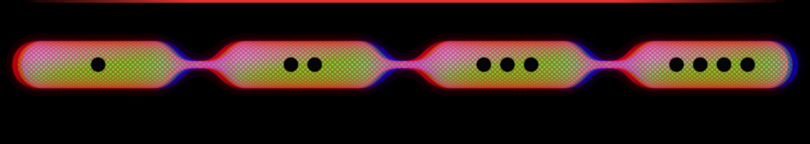

# Flow Bell

Four pills on your desktop. One click starts a block of focused work.




- 1 / 2 / 3 / 4 dots = 30 / 60 / 90 / 120 minutes. No settings.
- Click: a short organ piece plays, the pill dims from right to left.
- Time is up: a second, shorter organ phrase. Click a running pill to stop.
- Right-drag to move, right-click for the menu.

## Run (Windows)

```
pip install -r requirements.txt
pythonw flow_bell.py
```

Prefer the wooden board and three temple bells? Copy `sounds/open_board.mp3` over `sounds/open.mp3` and `sounds/close_bell.mp3` over `sounds/close.mp3`. Any mp3 works.

## Why one sound

Pick one sound, play it only when you actually start, keep it identical every time. That is what turns it into a cue.

Sound credits: [CREDITS.md](CREDITS.md). Code: MIT.
